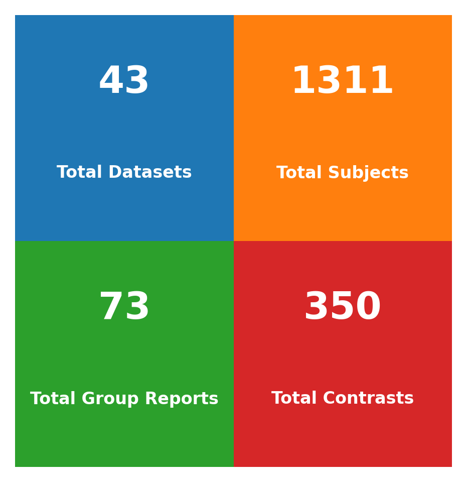

# OpenNeuro GLM Fitlins
[](https://doi.org/10.5281/zenodo.15376890)

**Curator & Maintainer**: Michael Demidenko  

> *This repository would not be possible if researchers did not make their task fMRI data publicly available, and the awesome people who have worked on and continue to work on OpenNeuro, BIDS Stats Models and Fitlins.*

**Contact**: [demidenko.michael@gmail.com](mailto:demidenko.michael@gmail.com)


## Overview

`openneuro_glmfitlins` provides a streamlined workflow for analyzing neuroimaging datasets using [FitLins](https://github.com/poldracklab/fitlins)</a> via [BIDS Stats Models](https://bids-standard.github.io/stats-models/). The repository supports both **OpenNeuro datasets** and **local "house" datasets**, generating comprehensive reports for datasets and tasks processed through GLM Fitlins, with two primary goals:

1. Facilitate efficient and reproducible neuroimaging data analysis
2. Provide minimal barriers to entry for researchers at all levels

The FitLins workflow estimates statistical maps (e.g., z-stat, t-stat) across several levels, including `runLevel` (subject-level run contrast maps), `subjectLevel` (fixed-effect averages across runs), and `dataLevel` (group-level average maps). Group results summarize the models and activation maps for each study and task. The provided specification files are sufficient to download and reproduce all outputs for OpenNeuro datasets, or to analyze your local datasets. If you are unable to run the workflow but are interested in outputs for any of the datasets listed in `statsmodel_specs`, please feel free to reach out.


*Note: If you're simply interested in looking at the task-specific group reports, all of that information is in the subfolders `statsmodel_specs/<studyID>/group_<taskname>`. *
> The modeling decisions reported here are only recommendations. Each analysis should embark on its own quality control, behavioral data evaluation and final sample selection.

## Quick start

```bash
git clone https://github.com/demidenm/openneuro_glmfitlins.git
cd openneuro_glmfitlins
bash setup_uv.sh                 # installs uv, creates the environment, prompts for paths (path_config.json)
uv run glmfitlins config         # check the resolved paths
uv run glmfitlins --help         # all commands
```

`path_config.json` needs at least `datasets_folder` (BIDS, fMRIPrep and FitLins outputs) and `tmp_folder` (scratch). See [docs/installation.md](docs/installation.md) for all keys, environment-variable overrides and prerequisites.

## Running a dataset

All steps are `glmfitlins` subcommands. Run them from the repository folder with `uv run` (or activate `.venv` and drop the `uv run`).

| Step | Command | What it does |
|---|---|---|
| 1 | `glmfitlins details <ds>` | Check S3, download BIDS + fMRIPrep (+ MRIQC), write study details, subjects/contrasts files, README |
| 2 | `sbatch scripts/cluster_jobs/recreate_fmriprep.sh <ds>` | Only if fMRIPrep derivatives are minimal (SLURM) |
| 3 | `glmfitlins events <ds> <task>` | Trim dummy volumes, apply event fixes, check missing events |
| 4 | `glmfitlins spec <ds> <task> [suffix]` | Create the model spec (`--update` re-copies edited subjects/contrasts/runs into an existing spec); `glmfitlins validate` checks it |
| 5 | `glmfitlins fit <ds> <task> [suffix]` | Run FitLins (`sbatch scripts/cluster_jobs/run_fitlins.sh` on a cluster) |
| 6 | `glmfitlins report <ds> <task> [suffix]` | Group report: figures + README in `statsmodel_specs/<ds>/group_<task>/` |

Example walk-through for `ds003425`, task `learning` (dataset and task can also be given as positionals, e.g. `details ds003425`, `events ds003425 learning`):

```bash
# 1. First we download the BIDS data and fMRIPrep derivatives and write the study details
#    (subjects, runs, volumes, README). Add --yes to skip the download (if data already downlaoded).
uv run glmfitlins details -d ds003425

# 2. Set the task's dummy volumes / event fixes (see docs/workflow.md: the details json and
#    src/openneuro_glmfitlins/events/datasets/ds003425.py), then run this to apply them
# this will also report missing events.
uv run glmfitlins events -d ds003425 -t learning

# 3. After creating the model spec from the template, subjects, runs and contrasts. Review/edit it;
#    an existing spec is never overwritten. If you edit the subjects/contrasts/basic-details
#    files, run with --update to copy those into the spec (your other spec edits shoul dbe retained).
uv run glmfitlins spec -d ds003425 -t learning

# 4. Basic spec validation: checks that Input.task/subject/run match the study files and that contrast
#    weights fit the Run-level conditions (add --check-design to build design matrices and check more indepth values for missingness/ris of errors).
uv run glmfitlins validate -d ds003425 -t learning

# 5. Now, fit with FitLins: a dry-run that only prints the command , a regular run (local, your machine) or a cluster job.
uv run glmfitlins fit -d ds003425 -t learning --dry-run            # show the FitLins command only

uv run glmfitlins fit -d ds003425 -t learning                      # regular run
uv run glmfitlins fit -d ds003425 -t learning -s 8:run:iso --n-cpus 8 --mem-gb 64   # override options

sbatch scripts/cluster_jobs/run_fitlins.sh -d ds003425 -t learning # SLURM submission

# 6. Finally, create the group report (figures + README in statsmodel_specs/ds003425/group_learning/).
uv run glmfitlins report -d ds003425 -t learning
```

**FitLins options and defaults consistent with [latest docs](https://fitlins.readthedocs.io/en/latest/usage.html#command-line-arguments).** `fit` options (`-s/--smoothing`, `-e/--estimator`, `--space`, `--desc-label`, `--ignore`, `--verbosity`, `--n-cpus`, `--mem-gb`) are all flags. Each value comes from, in order: the flag, then an optional `"fit"` block in `path_config.json` (e.g. `"fit": {"smoothing": "8:run:iso", "n_cpus": 8}`), then the built-in default. FitLins-specific defaults are `5:run:iso` smoothing, the `nilearn` estimator, space `MNI152NLin2009cAsym` and desc-label `preproc`. CPUs and memory are not fixed: they default to the SLURM job's request, or else the machine's CPUs and about 90% of its memory. Use `--dry-run` to see the values that will be used; the full table is in [docs/installation.md](docs/installation.md).

An optional model variant (`[suffix]` or `--suffix mod2`) runs it (files and folders are named `<task>-<suffix>`). Every command has `-h` with options and examples. Step-by-step details, example output and options are in [docs/workflow.md](docs/workflow.md).

## Documentation

- [Installation & configuration](docs/installation.md): prerequisites, dependencies, `path_config.json`, environment overrides
- [Analysis workflow](docs/workflow.md): each step in detail, house datasets, event fixes, spec options, FitLins and report options, legacy shell scripts
- [Repository layout & features](docs/repository.md): package structure and tests
- [Troubleshooting](docs/troubleshooting.md): common FitLins errors, removing downloaded data
- [Contributing](docs/contributing.md): reviewing specs/contrasts/event fixes, issue templates, adding a dataset

## Model Specs Available

*This repository is in active development. `Last updated: 2025-09-30`*




N OpenNeuro Studies: 57

N OpenNeuro Task fMRI Group Summaries: 106

Completed fMRI Task Names: 1dNF, 1Norm, 2dNF, 2Swallow, 3HandA, 4HandB, 5Eyes, 6DeepBreathing, abstractconcretejudgment, antisaccadetaskwithfixedorder, arithm, auditoryfeedback, balloonanalogrisktask, balloonanalogrisktask, ChangeDetection, cmp, ColorDots, compL1, compLn, conditionalstopsignal, covertverbgeneration, deterministicclassification, dis, discounting, doors, dts, ec, em, emotionalfaces, emotionalregulation, Emotionregulation, encoding, epr, eye, faceexplocalizer, faceidentityoddball, facerecognition, familiarity, fb, feedback, figure2backwith1backlures, fingerfootlips, flanker, flavor, FoodChoice, FoodStimHiLo, gas, gas, GDMotor, identify1, identify2, illusion, learning, letter0backtask, letter1backtask, letter2backtask, linebisection, Memory, MGT, mid, mid, MIDmb4, MIDmb8, MIDsingle, mixedeventrelatedprobe, mixedgamblestask, modulate1, modulate2, music, nofeedback, nonmusic, objectviewing, overtverbgeneration, overtwordrepetition, ParallelAdaptation, passiveimageviewing, pc, PenaltyKik, prelearning, probabilisticclassification, prodL1, prodLn, regulate, retrieval, reversalweatherprediction, roletrait, sae, sar, socialcomparison, socialdoors, stopsignal, stopsignal, task, theoryofmindwithmanualresponse, TrainedHandTrainedSequence, TrainedHandUntrainedSequence, training, UntrainedHandTrainedSequence, UntrainedHandUntrainedSequence, verbs, viewFigure, viewing, viewRandom, visualfeedback, weatherprediction, wm

## License

This project is licensed under the MIT License. See the LICENSE file for details.
