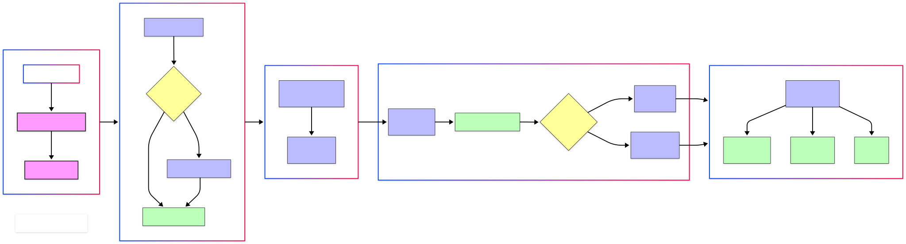

[← README](../README.md) · [Installation](installation.md) · [Workflow](workflow.md) · [Repository](repository.md) · [Troubleshooting](troubleshooting.md) · [Contributing](contributing.md)

# Analysis Workflow

Detailed description of each step. For a quick overview run `uv run glmfitlins --help`; every command also has `-h` with examples.



## Argument forms: positional or flags

Every command that takes a dataset and task accepts either form. They are equivalent and can be used in scripts and job files interchangeably:

```bash
uv run glmfitlins fit ds003425 learning mod2
uv run glmfitlins fit -d ds003425 -t learning --suffix mod2
```

| Flag | Meaning | Commands |
|---|---|---|
| `-d`, `--dataset` | dataset id (e.g. `ds003425`) | `details`, `events`, `spec`, `validate`, `fit`, `report`, `fit-summary` |
| `-t`, `--task` | task label | all of the above except `details` |
| `--suffix` | optional model variant (`<task>-<suffix>`) | `spec`, `validate`, `fit`, `report`, `fit-summary` |

Giving the same value in both forms is fine; giving different values is an error. The cluster script takes the same arguments: `sbatch scripts/cluster_jobs/run_fitlins.sh -d ds003425 -t learning`.

## 1. Download Data / Generate Summary

### For OpenNeuro Datasets (`"data_type": "openneuro"`) [default]

```bash
uv run glmfitlins details ds003425          # add --yes to skip the download question (batch jobs)
```

This step:
- Downloads the dataset from OpenNeuro and fMRIPrep derivatives
- Shows the size of the OpenNeuro & fMRIPrep directory for confirmation (download size can be reduced via `src/openneuro_glmfitlins/io/file_exclusions.json`; pass `--yes` to skip the question)
- Determines if preprocessed MNI NIfTI files are present to identify minimal vs. complete derivatives
- Generates summary files and metadata

### For House Datasets (`"data_type": "house"`)

```bash
uv run glmfitlins details datasetname
```
This step:
- Skips data download and size checks
- Directly generates summary files for your local dataset
- Creates necessary metadata files for analysis

To regenerate the details from data that is already downloaded (OpenNeuro or house), use `uv run glmfitlins details <ds> --skip-download` (add `--minimal yes` if the fMRIPrep derivatives are minimal). README and figures can be written elsewhere with `--out-dir`.

**Expected Data Structure:**
Your house dataset should follow BIDS format and be organized as follows:

```bash
# BIDS input data structure
ls input/datasetname/
CHANGES                   participants.tsv    
dataset_description.json  sub-01    
derivatives               ....         
dwi.json                        

# fMRIPrep derivatives structure
ls fmriprep/datasetname/
logs         sub-01.html  
README.md    sub-01       
dataset_description.json     ...
derivatives              
desc-aparcaseg_dseg.tsv   
desc-aseg_dseg.tsv      
```

**Note:** For proper workflow integration, the `fmriprep/datasetname/derivatives/` directory holds hard links of the `fmriprep/dataset_id/` root directory contents in case of full fMRIPrep'd derivatives. In cases of minimal fMRIPrep'd derivatives, this directory will be created with the resulting fMRIPrep'd outputs.

**Both dataset types generate:**
- A README summarizing the dataset
  - Note: at the base of the README [example](../statsmodel_specs/ds003425/README.md), there will be links to the plotted distributions of <a href="https://mriqc.readthedocs.io/en/latest/iqms/t1w.html" target="_blank">structural</a> and [functional](https://mriqc.readthedocs.io/en/latest/iqms/bold.html) MRIQC quality control metrics. (which will not be provided for in-house data)
- A details JSON file with metadata (subjects, sessions, tasks, BOLD volumes, event columns, trial types)
- Subject and contrast list files for each task

## 2. Minimally Preprocessed --> Fully Preprocessed fMRIPrep derivatives 

***ONLY if fMRIPrep derivatives == minimal***

Within the `scripts/cluster_jobs` subfolder, submit the job with the OpenNeuro ID: Update your SBATCH specific information (e.g. `--mail-user`, `-p`, and `--time` for larger datasets and subejct-specific `--array`. The subject-specific (e.g. 1-30), dynamically-grabs the positions value for each subject from the `./statsmodels_specs/ds000000/ds000000_basic-details.json` to subject each job individual. Ensure the lengths match.
```json
{
    "Subjects": [
        "01", <- SLURM job 1, if --array=1-5
        "02",
        "03",
        "04",
        "05", 
        ...
    ]
...
}
```

To submit the jobs, simply run:

```bash
sbatch recreate_fmriprep.sh ds003425
```


> To run fmriprep, you will need a singularity container which you can build using: `singularity build /path/fmriprep-<version>.sif  docker://nipreps/fmriprep:<version>`


## 3. Modify Events/BOLD/Confound Files and Check Event Counts

```bash
uv run glmfitlins events ds003425 learning
```

This step:
- Trims initial volumes from preprocessed BOLD data and confound files, if needed, if calibration/dummy volumes `dummy_volumes` flag in the details JSON `> 0` (writes out files to `derivatives_alt` subfolder)
- Modifies events files in place, if needed, based on the `preproc_events` flag in the details JSON. The first time a file is changed, the original is saved next to it as `*_events.tsv.orig`; later runs re-apply the fix to that original, so re-running is safe.
- Exits with an error if any file could not be processed
- The modified BOLD and/confounds files are saved to `derivatives_alt` fMRIPrep subfolder. Associated `.json` files (metadata FitLins needs) are copied there too. `glmfitlins fit` uses `derivatives_alt` automatically when it exists.
- Checks whether subjects have equal events files for each run and/or session (skip with `--no-missing-check`). Reports to terminal. This check should be used to 1) double check the exist files and 2) adjust subject/runs in the model specs, accordingly.

Example for `ds001229 EM task`
```bash
_________ANALYZING TASK: *em* one session_________

Subjects with incomplete event files:
18: 2 event file(s) (missing N = 1 runs)

All subjects have event files

_____Summary of Missing Files_____
Total alerts: 1
⚠️ Subject 18 is missing 1 event file(s)
```

Example for `ds003425 prelearning task`
```bash
_________ANALYZING TASK: *prelearning* across 2 sessions:['01', '02']_________

=== Analysis for Session: 01 ===

Subjects with incomplete event files:
01: 2 event file(s) (missing N = 1 runs)
05: 2 event file(s) (missing N = 1 runs)

All subjects have event files

=== Analysis for Session: 02 ===

All subjects with events have complete files

Subjects with NO event files:
Subject 09
Subject 01
Subject 06
Subject 11
Subject 08
Subject 10
Subject 03
Subject 05
Subject 04
Subject 07
Subject 02
Subject 12
Subject 13

_____Summary of Missing Files_____
Total alerts: 15
⚠️ Session 01: Subject 01 is missing 1 event file(s)
⚠️ Session 01: Subject 05 is missing 1 event file(s)
⚠️ Session 02: Subject 09 has NO event files
⚠️ Session 02: Subject 01 has NO event files
⚠️ Session 02: Subject 06 has NO event files
⚠️ Session 02: Subject 11 has NO event files
⚠️ Session 02: Subject 08 has NO event files
⚠️ Session 02: Subject 10 has NO event files
⚠️ Session 02: Subject 03 has NO event files
⚠️ Session 02: Subject 05 has NO event files
⚠️ Session 02: Subject 04 has NO event files
⚠️ Session 02: Subject 07 has NO event files
⚠️ Session 02: Subject 02 has NO event files
⚠️ Session 02: Subject 12 has NO event files
⚠️ Session 02: Subject 13 has NO event files
```


**Important**: For event preprocessing, add a module for your study in `src/openneuro_glmfitlins/events/datasets/` (e.g. `ds003425.py`; copy an existing one as a template). The function receives the events table and returns the modified table, or `None` when nothing needs to change. It should not write files; the pipeline writes the result and keeps the `.orig` backup. List registered datasets with `uv run glmfitlins event-fixes`. Example:

```python
import pandas as pd

from ..common import EventsContext
from ..registry import register_events


@register_events("ds003425")
def ds003425(events_df: pd.DataFrame, task: str, ctx: EventsContext):
    """Model the first and last CS- trials as a separate regressor (trial_type 6)."""
    if task in ["learning", "prelearning", "regulate"]:
        eventsdat = events_df.copy()
        if 6 not in eventsdat['trial_type'].values:
            filtered_events = eventsdat[eventsdat['trial_type'].isin([4, 5])]
            if not filtered_events.empty:
                first_and_last_events = filtered_events.iloc[[0, -1]].copy()
                first_and_last_events['trial_type'] = 6
                return pd.concat([eventsdat, first_and_last_events], ignore_index=True)
        else:
            print(f"Trial type value '6' already contained in {ctx.path.name}. Skipping.")
    return None
```

## 4. Create Model Specification File

The creation of the model specification file has two options:

Option 1: task-to-output matching
```bash
uv run glmfitlins spec ds003425 learning

# returns ds003425-learning_specs.json
```

Option 2: multi-verse option with optional suffix
```bash
uv run glmfitlins spec ds003425 learning mod2

# returns ds003425-learning-mod2_specs.json
```

A variant without its own `ds003425-learning-mod2_contrasts.json` / `_subjects.json` uses the task's files (`ds003425-learning_contrasts.json`, `ds003425-learning_subjects.json`).

### When to use `--update`

The spec is a **copy** of values from other files, made when it is first created. Plain `spec` never overwrites an existing spec file (so your hand edits are safe); it only re-runs the design check. If you change a source file afterwards, the spec does not follow, and FitLins (which reads only the spec) would use the old values.

| You changed... | Spec field that is now stale | Action |
|---|---|---|
| `<ds>-<task>_subjects.json` (e.g. excluded a subject) | `Input.subject` | `spec --update` |
| `<ds>-<task>_contrasts.json` (added/edited a contrast) | Run-node `Contrasts` | `spec --update` |
| `<ds>_basic-details.json` (`task_runs`, `task_sessions`; e.g. after re-running `details`) | `Input.run`, `Input.session` | `spec --update` |
| the spec itself (model, nodes, transformations, smoothing) | nothing, you edited the source of truth | nothing; do not use `--update` |
| anything and you want a fresh copy of the template | everything | delete the spec file, then `spec` |

What `--update` does:
- Re-reads the subjects, contrasts and basic-details files and rewrites **only** `Input.subject`, `Input.run`, `Input.session` and the Run-node `Contrasts`.
- Leaves everything else untouched (other nodes, transformations, model, your edits).
- Prints each change (`UPDATED derived fields: ...`), or says the spec is already up to date and writes nothing.
- Needs the subjects and contrasts files to exist.
- Does **not** re-run FitLins; re-run `fit` afterwards for the changes to take effect.

```bash
uv run glmfitlins spec ds003425 learning --update
```

Not sure whether the spec is stale? `validate` (below) compares it with those files and warns on drift, without changing anything.

To check a spec for drift from its subjects/contrasts/basic-details files and for inconsistent contrast weights (exits non-zero on errors):
```bash
uv run glmfitlins validate ds003425 learning            # add --check-design to also build design matrices
```

This step:
- Creates a BIDS Stats Models specification (e.g. spec for [ds003425_task-learning](../statsmodel_specs/ds003425/ds003425-learning_specs.json)) file based on the task, subjects, and contrasts
- Generates a template that should be reviewed and potentially modified before running FitLins
- Customizations might include changing transformations, adding temporal derivatives, or removing processing nodes
- After the file is created, the final code confirms that the conditions in contrasts in the spec file match the columns available in resulting design matrix created by BIDS Stats Models. Example report in terminal:

```bash
Confirming contrast conditions map to available design matrix columns.
** All contrast conditions are present in at least one design matrix. ** 

Conditions used in contrasts specification exist in all design matrices.
```

## 5. Run FitLins Model

Similar to step-4, which creates the specification file, running the Fitlins model has an optional `suffix`option to differentiate the specification file (e.g. `learning` or `learning-mod2`) and the resulting output folder name (e.g. `<output>/analysis/ds003425/task-learning` or `<output>/analysis/ds003425/task-learning-mod2`)

### 5a. On Local Machine

```bash
# without suffix
uv run glmfitlins fit ds003425 learning

# with suffix
uv run glmfitlins fit ds003425 learning mod2

# options (same on the cluster script below)
uv run glmfitlins fit -s 8:subject:iso -e afni --n-cpus 8 --mem-gb 64 ds003425 learning
uv run glmfitlins fit --dry-run ds003425 learning     # print the FitLins command only
uv run glmfitlins fit -h
```

### 5b. On HPC cluster

`scripts/cluster_jobs/run_fitlins.sh` is an SBATCH header around `glmfitlins fit`; it passes the requested CPUs and memory to FitLins and accepts the same options. Within the `scripts/cluster_jobs` subfolder, submit the job with the OpenNeuro ID and the task name. Note: Update your SBATCH specific information (e.g.  mail options `--mail-user`, partition `-p`, account `-a`, and run time `--time` for larger datasets)

**Basic usage:**

```bash
# without suffix
sbatch run_fitlins.sh ds003425 learning

# with suffix
sbatch run_fitlins.sh ds003425 learning mod2
```

**Smoothing /Estimator options:**
There are additional Fitlins [usage](https://fitlins.readthedocs.io/en/latest/usage.html) options. 

```bash
# Using alt smoothing kernel, e.g. 8mm FWHM at subject level with isotropic smoothing (as opposed to default 5mm smoothing at run level)
sbatch run_fitlins.sh -s 8:subject:iso ds003425 learning

# Using AFNI estimator
sbatch run_fitlins.sh -e afni ds003425 learning

# Combined
sbatch run_fitlins.sh -s 6:dataset:isoblurto -e nilearn ds003425 learning

# View available options
sbatch run_fitlins.sh -h
```

**Available options:**

- `-s <smoothing>`: Customize BOLD series smoothing (default: `5:run:iso`)
  - Format: `FWHM:LEVEL:TYPE`
  - FWHM: kernel size in mm
  - LEVEL: `run`, `subject`, `session`, `dataset`, or `l1`
  - TYPE: `iso` (isotropic additive) or `isoblurto` (progressive isotropic)

- `-e <estimator>`: Choose the GLM estimator (default: `nilearn`)
  - `nilearn`: Default estimator using nilearn.glm
  - `afni`: Uses 3dREMLfit for fitting models

- `--n-cpus` / `--mem-gb`: resources passed to FitLins (defaults 6 / 32 locally; the SLURM script uses the SBATCH request)
- `--space` / `--desc-label`: BOLD space and desc label (defaults `MNI152NLin2009cAsym` / `preproc`)
- `--dry-run`: print the FitLins command without running it

This executes the FitLins analysis based on the specification file. Results will be stored in `<datasets_folder>/analyses/<studyID>/task-<taskname>` (or `task-<taskname>-<suffix>`).

## 6. Generate Aggregate Report for Study Task (optional)

```bash
# without suffix
uv run glmfitlins report ds003425 learning

# with suffix
uv run glmfitlins report ds003425 learning mod2
```

Options: `--out-dir DIR` (write `group_<task>[-<suffix>]/` somewhere other than `statsmodel_specs/<studyID>/`), `--zstat-thresh` (default 2.3), `--dice-thresh` (0.85), `--voxout-thresh` (0.10), `--n-workers`.

This executes a command that will return images and README file based on your study details and task-specific specification and Fitlins output. Similar to [ds003425 regulate task](../statsmodel_specs/ds003425/group_regulate/), you'll obtain model, regressor and contrast maps.


## Other commands

```bash
uv run glmfitlins validate ds003425 learning       # spec drift / contrast weight check
uv run glmfitlins event-fixes                      # datasets with registered event fixes
uv run glmfitlins fit-summary ds003425 learning    # count FitLins outputs per node level
uv run glmfitlins dashboard --out-dir docs         # cross-dataset summary figure
```

## Legacy shell scripts

The numbered scripts in `scripts/` still work but only forward to the CLI (they print a note saying so). Prefer the commands:

| Old script | Command |
|---|---|
| `bash 1_download_data_create_details.sh ds003425` | `uv run glmfitlins details ds003425` |
| `bash 2_modifycheck_boldeventfiles.sh ds003425 learning` | `uv run glmfitlins events ds003425 learning` |
| `bash 3_create_spec_file.sh ds003425 learning [mod2]` | `uv run glmfitlins spec ds003425 learning [mod2]` |
| `bash 4_run_fitlins.sh [-s ...] [-e ...] ds003425 learning [mod2]` | `uv run glmfitlins fit [-s ...] [-e ...] ds003425 learning [mod2]` |
| `bash 5_run_groupreport.sh ds003425 learning [mod2]` | `uv run glmfitlins report ds003425 learning [mod2]` |
